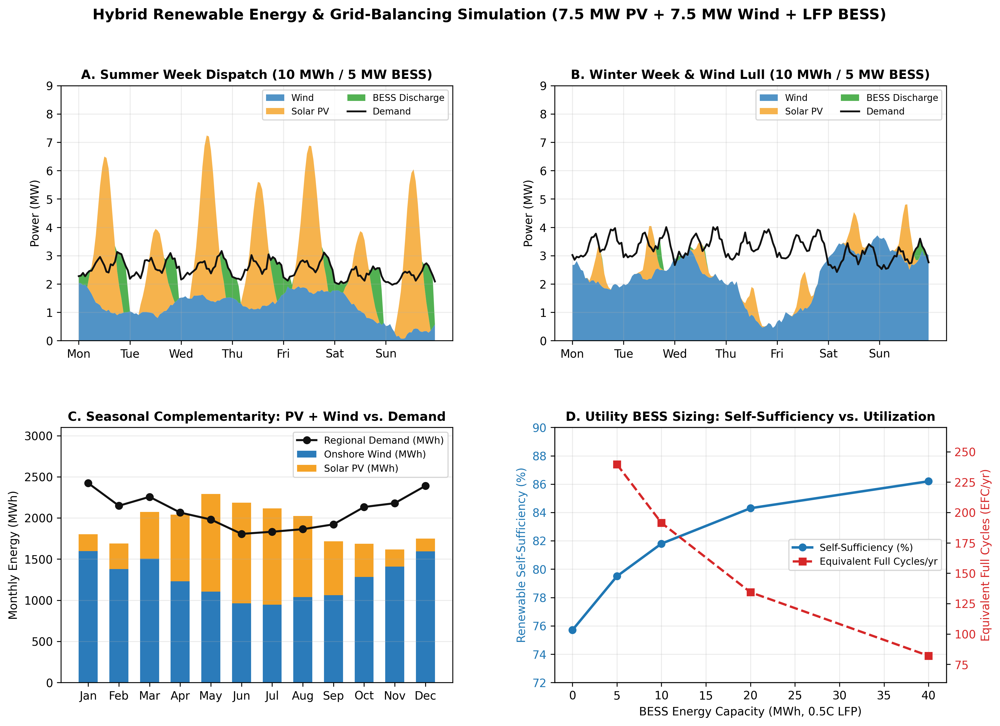

# Hybrid Solar PV, Wind & Battery Storage (BESS) Dispatch Model

An 8,760-hour Python energy-system simulation evaluating hourly generation-load balancing, seasonal complementarity, and utility-scale LFP battery dispatch for a **15 MW hybrid renewable portfolio (7.5 MW Solar PV + 7.5 MW Onshore Wind)** serving a **25,000 MWh/yr** regional demand profile in Bavaria, Germany.



## 1. System Architecture & Modeling Assumptions

Parametric hourly profiles are calibrated to Southern German (Bavaria) generation benchmarks and BDEW-style regional consumption patterns:

| Component | Specification | Annual Total / Benchmark | Reference Basis |
| :--- | :--- | :--- | :--- |
| **Solar PV** | 7.5 MWp utility-scale | 7,875 MWh/yr (~1,050 kWh/kWp/yr) | Fraunhofer ISE / PVGIS (Southern Germany) |
| **Onshore Wind** | 7.5 MW wind park | 15,111 MWh/yr (23.0% capacity factor) | Fraunhofer IEE / BNetzA onshore benchmarks |
| **Regional Load** | Commercial & municipal feeder | 25,000 MWh/yr (91.9% gross RE share) | BDEW seasonal, diurnal & weekday profiles |
| **LFP BESS** | 0–40 MWh, 0.5C (2-hour duration) | 92% round-trip efficiency, 10%–90% SoC | Fraunhofer ISE / NREL utility LFP guidelines |

### Dispatch Control Logic
1. **Surplus Generation (`PV + Wind > Load`):** Excess renewable power charges the LFP battery first (bounded by the 0.5C inverter limit and 90% max SoC); remaining surplus is exported to the grid.
2. **Generation Deficit (`PV + Wind < Load`):** The battery discharges first to cover the shortfall (down to 10% min SoC); any residual deficit is imported from the grid.

## 2. Simulation Results Across BESS Sizes

| BESS Capacity (MWh) | Power Rating (MW) | Self-Sufficiency (%) | Self-Consumption (%) | BESS Discharge (MWh/yr) | Grid Import (MWh/yr) | Surplus Export (MWh/yr) | Full Cycles (EFC/yr) |
| :---: | :---: | :---: | :---: | :---: | :---: | :---: | :---: |
| **0** | 0.0 | 75.7% | 82.3% | 0 | 6,086 | 4,072 | 0.0 |
| **5** | 2.5 | 79.5% | 86.8% | 958 | 5,127 | 3,028 | 239.6 |
| **10** | 5.0 | 81.8% | 89.5% | 1,532 | 4,554 | 2,403 | 191.4 |
| **20** | 10.0 | 84.3% | 92.4% | 2,149 | 3,937 | 1,736 | 134.3 |
| **40** | 20.0 | 86.2% | 94.7% | 2,624 | 3,462 | 1,228 | 82.0 |

## 3. Key Engineering Takeaways
* **Seasonal Complementarity:** Pairing summer-peaking solar PV with winter-peaking onshore wind achieves **75.7% direct hourly self-sufficiency** before adding any storage.
* **Optimal BESS Sizing:** A **10–20 MWh (5–10 MW) 2-hour LFP battery** captures daily midday solar and windy-night surpluses, lifting renewable self-sufficiency to **81.8%–84.3%** while maintaining strong asset utilization (**134–191 equivalent full cycles/year**).
* **Diminishing Returns at Large Scale:** Scaling to 40 MWh adds only +1.9 percentage points in self-sufficiency over 20 MWh while dropping utilization to 82 EFC/yr, as multi-day winter wind lulls (*Dunkelflaute*) cannot be bridged economically by short-duration storage alone.

## 4. How to Run
```bash
pip install numpy pandas matplotlib
python hybrid_dispatch_model.py
